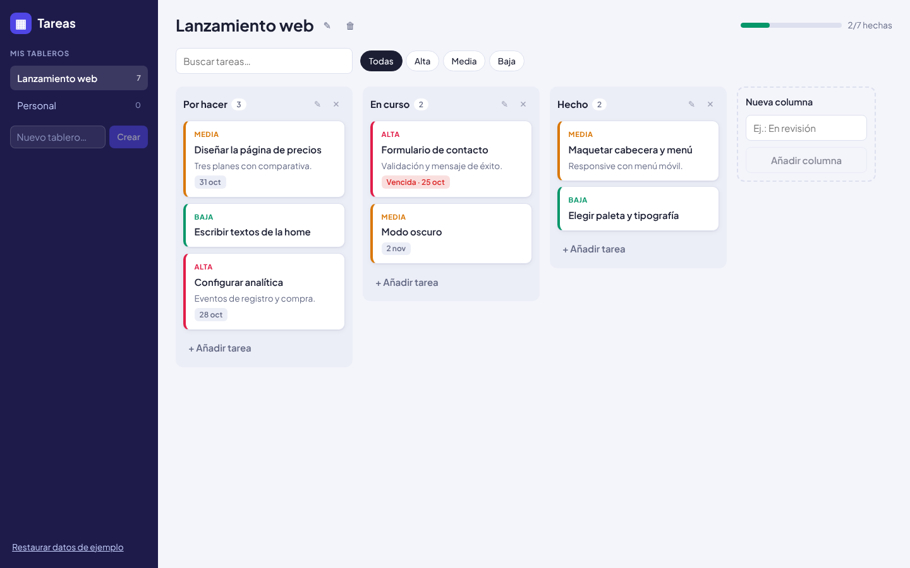
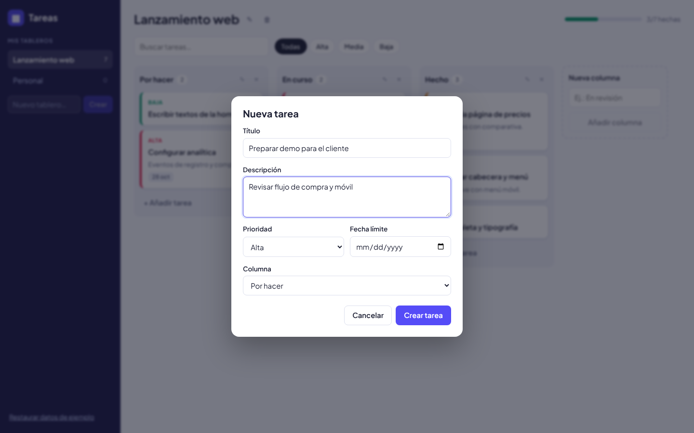
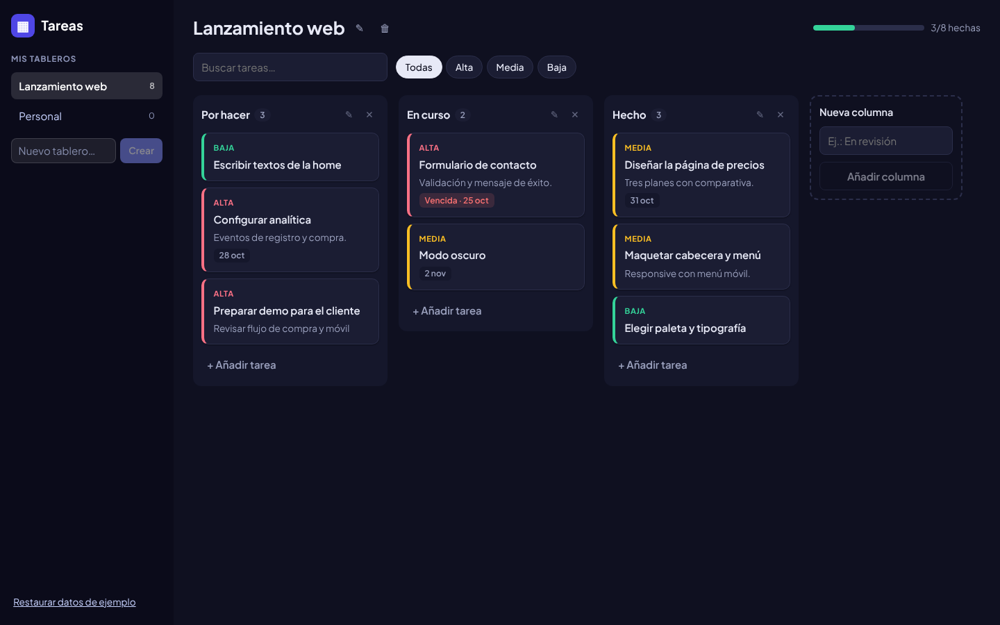
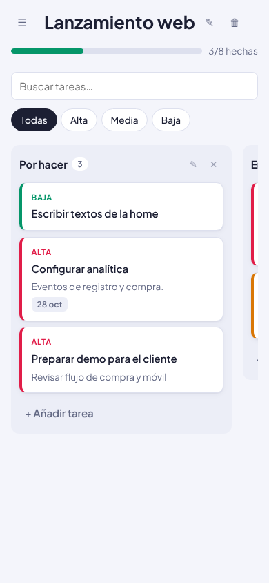

# Tareas · Gestor Kanban en Angular

Gestor de tareas tipo Trello: varios tableros, columnas personalizables y tarjetas que se arrastran entre columnas. Hecho con **Angular 22**, **signals** y el **drag & drop del Angular CDK**.

**Demo:** https://zitroolrac.github.io/tareas-angular/



## Funcionalidades

- **Varios tableros**: crear, renombrar, borrar y cambiar entre ellos desde la barra lateral.
- **Columnas personalizables**: añadir, renombrar (doble clic) y borrar. Al borrar una columna se pide confirmación y se indica cuántas tareas se eliminan.
- **Tareas** con título, descripción, prioridad (alta, media, baja) y fecha límite. Las vencidas se marcan en rojo.
- **Drag & drop** entre columnas y para reordenar dentro de la misma columna.
- **Alternativa accesible al drag & drop**: desde el formulario de la tarea se puede cambiar de columna con un selector, sin ratón.
- **Búsqueda** que ignora tildes y mayúsculas ("camion" encuentra "Camión") y **filtro por prioridad**.
- **Barra de progreso**: tareas en la última columna sobre el total.
- **Persistencia en `localStorage`**: al recargar, todo sigue igual. Si los datos guardados están corruptos se ignoran y se carga el tablero de ejemplo.
- **Responsive** (menú lateral desplegable en móvil) y **modo oscuro** automático según el sistema.

| Editar tarea | Modo oscuro | Móvil |
| --- | --- | --- |
|  |  |  |

## Cómo está hecho

```
src/app/
├── models.ts            Tipos: Board, Column, Task, filtros
├── board.logic.ts       Funciones puras que transforman el estado (añadir, mover, borrar…)
├── board.logic.spec.ts  Tests de esas funciones
├── board.store.ts       Servicio con signals: estado global + guardado en localStorage
├── seed.ts              Tablero de ejemplo
├── app.ts / app.html    Layout: barra lateral, cabecera, búsqueda y filtros
├── board/               Columnas con drag & drop (CDK)
├── task-card/           Tarjeta de una tarea
├── task-dialog/         Formulario de crear/editar en un <dialog> nativo
└── autofocus.ts         Directiva para dar foco a los campos al editar
```

Decisiones principales:

- **Estado con signals, sin librerías externas.** `BoardStore` guarda todo en un `signal`; los componentes leen `computed`s (tablero activo, progreso, columnas filtradas) y llaman a métodos del store. Un `effect` guarda en `localStorage` cada vez que cambia el estado.
- **Lógica separada de la UI.** Todas las operaciones (mover, borrar, filtrar…) son funciones puras en `board.logic.ts`: reciben un tablero y devuelven uno nuevo sin mutar el original. Por eso se testean sin montar componentes.
- **Datos normalizados.** Las tareas se guardan en un mapa `tasks[id]` y cada columna solo guarda el orden (`taskIds`). Mover una tarea es cambiar un id de una lista a otra.
- **Componentes standalone y control flow nuevo** (`@if`, `@for`), `input()` / `output()` e `inject()`. La app funciona sin Zone.js (*zoneless*).
- **`<dialog>` nativo** para el formulario: gestiona el foco, la tecla Escape y el fondo sin código extra.
- **Formularios reactivos** con validación (el título es obligatorio y no puede ser solo espacios).
- Mientras hay un filtro activo, el arrastre se desactiva, porque las posiciones visibles no coinciden con las reales.

## Tests

16 tests con Vitest: la lógica del tablero (mover, reordenar, borrar columnas con sus tareas, filtros con tildes, fechas vencidas, validación del estado guardado) y la app montada (render del tablero, filtro por prioridad y guardado en `localStorage`).

```bash
npm test
```

## Ejecutar en local

```bash
npm install
npm start          # http://localhost:4200
npm run build      # build de producción en dist/
npm run deploy     # publica en GitHub Pages (rama gh-pages)
```

## Tecnologías

Angular 22 · TypeScript · Signals · Angular CDK (drag & drop) · Reactive Forms · Vitest · CSS con variables (sin frameworks) · GitHub Pages

---

Hecho por **Carlo Fabian Prado Ortiz** · [Portafolio](https://zitroolrac.github.io/Portfolio/) · [GitHub](https://github.com/ZitroOlrac)
